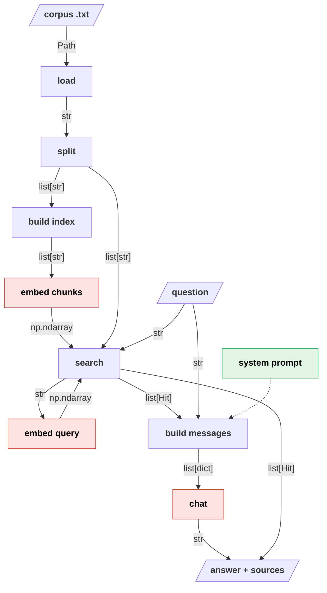

# Pipeline diagram

Five stages, with the data type on every arrow. Red boxes are the paid OpenAI calls. The green box is my Step 4 change.



## Reading it

- **Stages:** load and split are in `corpus.py` (chunks of 1000 chars, 200 overlap). Build index and search are in `index.py` (cosine similarity, top k=3). Build messages and chat are in `answer.py`.
- **Sizes:** the corpus is 16,206 chars, split into 21 chunks. The chunk matrix is (21, 1536) and the query vector is (1536,). Search returns up to k Hits, and the messages are a system and a user message.
- **Models:** both embed boxes use `text-embedding-3-small`. Chat is `gpt-4.1-mini` at temperature 0.
- **System prompt:** rewritten in Step 4. Answer fully, answer partly and say what's missing, or say "I don't know". No inference, no going along with false premises.

- **Paid calls:** the embeddings call (used twice: once to embed all 21 chunks, once per question) and the chat call. Indexing costs about 4,467 tokens and happens on every run, because nothing is saved to disk.
- **Row i of the matrix is chunk i.** That's the only link between a score and its text, which is why `chunk_id` in each `Hit` matches the `[chunk N]` labels in the prompt and the Sources list.
- **The query must use the same embedding model as the index**, or the scores mean nothing.
- **My Step 4 change** only touches the system prompt going into build messages. Retrieval is unchanged, which is why Q1, Q2 and Q9 still fail.

## Testing it on my 10 questions

`tests/run_questions.py` runs every question in `tests/manual_questions.csv` through the same pipeline as the app. It embeds the corpus once, then calls search and chat for each question, and writes the results to `tests/results/<tag>.md`.

From the Week 1 folder:

```
uv run python tests/run_questions.py --tag after
uv run python tests/run_questions.py -k 5 --tag k5
```

- `--tag` names the results file. Use a new tag each time, because rerunning with the same tag overwrites the file, including any notes added by hand.
- `-k` sets how many chunks to retrieve (default 3).
- The Pass and "What went wrong, where" columns are left empty. I filled them in by reading each answer.

Results so far:

- `tests/results/before.md`: the original prompt, 3/10.
- `tests/results/after.md`: the rewritten system prompt, 6/10.
